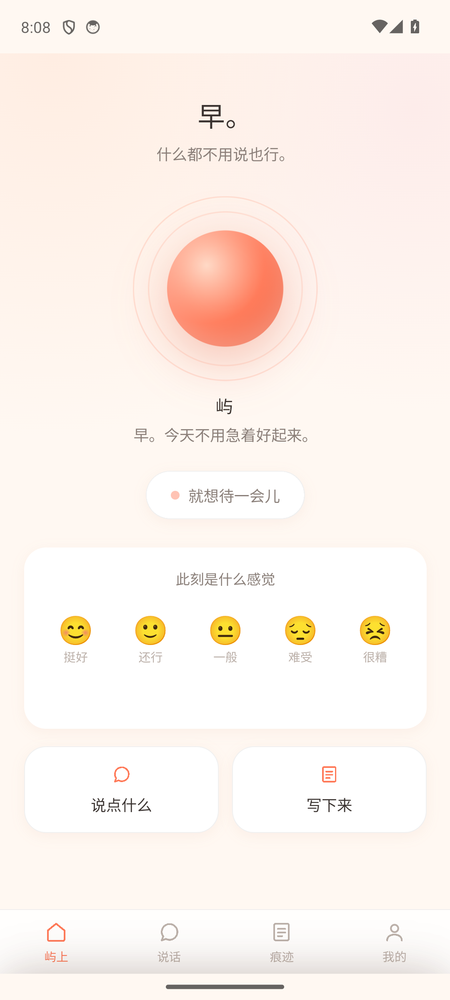
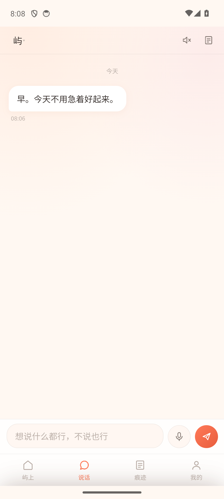
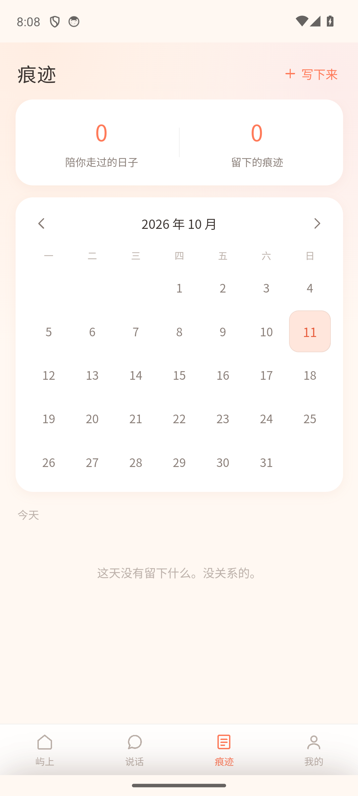
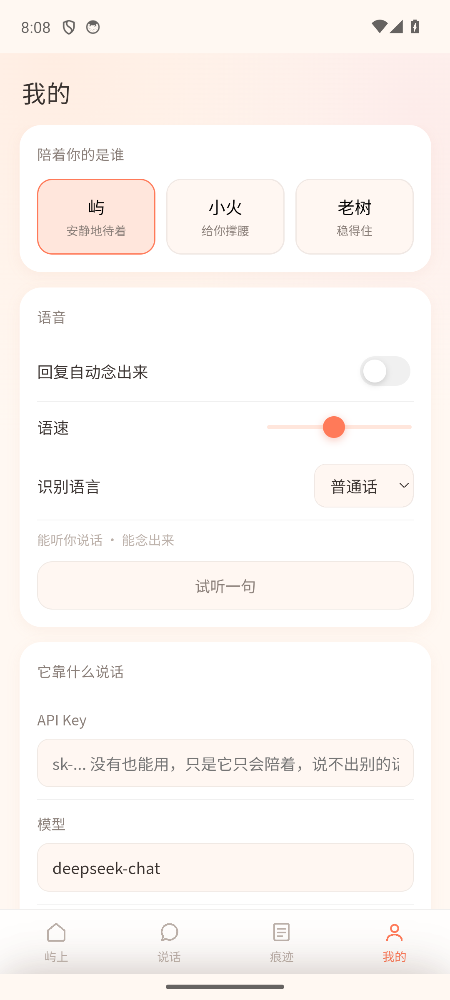
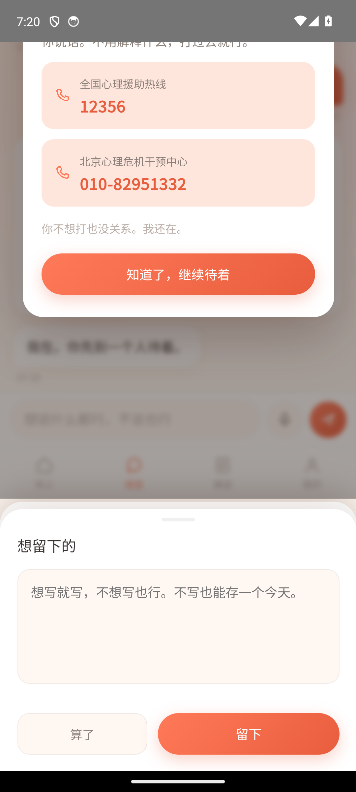

# 暖屿

> **只要陪伴，不用解释。**

一个安卓上的 AI 情绪陪伴应用。它的作用是**安慰**，不是引导你说出自己的脆弱。

---

## 它跟别的"心理陪伴 App"差在哪

大多数情绪陪伴类 App 会一进来就问你「最近压力大吗？压力来源是什么？」，用访谈式的提问
引导你把脆弱说出来。**暖屿不做这件事。**

| 那类 App 的做法 | 暖屿的做法 |
|---|---|
| 开局「开始访谈」，连问三个问题 | 一句「**我在。什么都不用说也行。**」 |
| 追着问「发生什么了」「能多说点吗」 | **默认不用问句**。你不说，它就不问 |
| 引导你袒露脆弱、分析你的情绪 | 不分析、不诊断、不贴标签 |
| 「想开点」「没事的」「别人也这样」 | 这些是**禁语**，一句都不会说 |
| 给你建议、讲道理 | 除非你明确问"我该怎么办"，否则不建议 |
| 用量表打分、贴"焦虑/抑郁"标签 | 打卡只有「挺好/还行/一般/难受/很糟」 |

这条原则**写死在模型系统提示词里**，不是一句宣传语 —— 见
[`app/js/persona.js`](app/js/persona.js) 的 `IRON_RULES`：

```
1. 禁止追问。任何试图获得更多信息的问句都不许说 —— 默认全程不用问号。
2. 禁止引导他袒露脆弱。不暗示"说出来会好受些"。
3. 禁止分析、诊断、贴标签。
4. 禁止否定情绪。"没事的""想开点"是禁语 —— 它们在替他把情绪缩小。
5. 禁止说教、讲道理、给建议。
6. 禁止程式化共情。"我理解你的感受" —— 你并不知道。
7. 记忆只用于让他此刻舒服，绝不主动提起他过去的痛苦经历。
```

**因此故意不做**：心境自测量表、情绪趋势分析周报、日记的引导式提问模板。

---

## 截图

| 屿上（首页） | 说话（聊天） |
|---|---|
|  |  |

| 痕迹（记录） | 我的（设置） |
|---|---|
|  |  |

**危机守护**：说到"不想活了"这类话时，把热线轻轻放到面前 —— 不追问细节、不说教、
不用"你不能这样想"堵人，给完号码继续陪着。



---

## 功能

- **三位伙伴**，都是安慰者，只是温度不同：**屿**（安静地待着）、**小火**（给你撑腰）、**老树**（稳得住）
- **语音**：点一下麦克风说话、再点一下停（不用一直按着，累的时候手指不用使劲）；
  回复也能念出来
- **陪伴模式**：点「就想待一会儿」，光球呼吸变慢，响起像远处海浪的声音（WebAudio 实时合成，零音频素材）
- **心情打卡**：只记录当下是什么感觉，点完只回一句安抚，**不问为什么**
- **痕迹**：日历回看，只想留个表情也行，一个字不写也能存
- **本地陪伴模式**：不填 API Key 也能用，内置的安慰语句按同一套原则写的
- **数据不出手机**：全在本地 localStorage，没有账号、没有云端

---

## 安装

下载 [`dist/暖屿_安卓v1.0.apk`](dist/暖屿_安卓v1.0.apk)（3.9 MB），传到手机点开安装。
系统提示"未知来源"是因为这是 debug 签名包，选继续安装即可。

> ⚠️ **换新版本请直接覆盖安装，不要先卸载** —— 卸载会连你说过的话一起删掉。

不填 Key 也能用。想让它真正会聊天，去
[platform.deepseek.com](https://platform.deepseek.com) 拿一个 API Key，
填进 App 的「我的 → API Key」。**Key 只存在你手机里，不上传任何服务器。**

---

## 技术结构

Capacitor 6 外壳 + 原生 Java 桥。网页层做 UI（改起来快），原生层只做网页做不到的三件事：

```
暖屿手机版_apk/
├── app/                      ← Web 源码（真正要改的地方）
│   ├── index.html
│   ├── css/app.css
│   └── js/
│       ├── persona.js        灵魂：人设 +「只安慰不引导」铁律 + 危机识别
│       ├── comfort.js        本地陪伴模式（无 Key 兜底）：只接住、只站队
│       ├── ai.js             双通道流式（原生桥 / fetch），统一接口
│       ├── voice.js          语音识别 + 播报
│       ├── store.js          本地存储
│       ├── ui.js             渲染零件
│       └── app.js            主逻辑
├── android/                  ← Capacitor 工程（含手写的原生桥）
│   └── app/src/main/java/com/philia/nuanyu/MainActivity.java
├── _scripts/                 ← 构建与验证工具
│   ├── build-apk.js          一条命令走完打包三步
│   ├── sync-www.js           app/ → www/（先清空再复制）
│   ├── make-icons.py         图标（Pillow 画的，零素材）
│   ├── cdp.js                在真机 WebView 里执行 JS / 真点击 / 截图
│   └── mock-llm.js           本地假模型，用来验证流式通道
├── dist/                     ← 交付的安装包
└── docs/screenshots/
```

**原生桥**（`MainActivity.java`）提供了三件网页做不到的事：

| 能力 | 实现 | 为什么必须原生 |
|---|---|---|
| 语音识别 | 系统 `SpeechRecognizer` | WebView 不支持 Web Speech API |
| 语音播报 | 系统 `TextToSpeech` | 同上 |
| 流式聊天 | `HttpURLConnection` 逐行读 SSE | WebView 里 fetch 跨域会被 CORS 拦死 |

原生事件统一走 `window.__nuanyu._on(jsonString)` 回到网页。

---

## 自己编译

需要 JDK 17 + Android SDK（本机在 `E:\android`）：

```powershell
npm install
node _scripts/build-apk.js      # sync-www → cap sync → gradlew assembleDebug
```

产物在 `android/app/build/outputs/apk/debug/app-debug.apk`。

出包前记得把 `android/app/build.gradle` 的 `versionCode` 加 1，否则安卓不会覆盖安装。

**踩过的坑都记在 [`打包说明.md`](打包说明.md) 里**（10 条实测记录，含两个真 bug 的根因分析）：
gradle 发行版要走国内镜像、Java 不读 Windows 代理、AGP 拒绝中文路径、
`overflow:hidden` 缺失导致隐藏浮层被滚出来、事件通道的 `if (!id) return` 吞掉语音事件……

---

## 想改它

- **觉得它还是会追问** → 改 `app/js/persona.js` 的 `IRON_RULES` 加措辞，不用动别处
- **想加一位伙伴** → 在 `app/js/persona.js` 的 `COMPANIONS` 数组里加一项
- **本地兜底话不够** → 改 `app/js/comfort.js` 的句库

---

## 如实说明

- **语音识别**用的是手机系统自带引擎，免费、中文效果取决于你手机的系统语音服务
- 这是 **debug 签名包**，能覆盖安装，但不是发布级签名，上架需另做正式 keystore
- 没有账号体系；数据全在本机，卸载即消失

## 如果你现在很危险

暖屿不是医生，不做治疗，它只能陪着你。真正撑不住的时候，请让真人接住你：

- **全国心理援助热线 12356**
- **北京心理危机干预中心 010-82951332**
